<div align="center">

  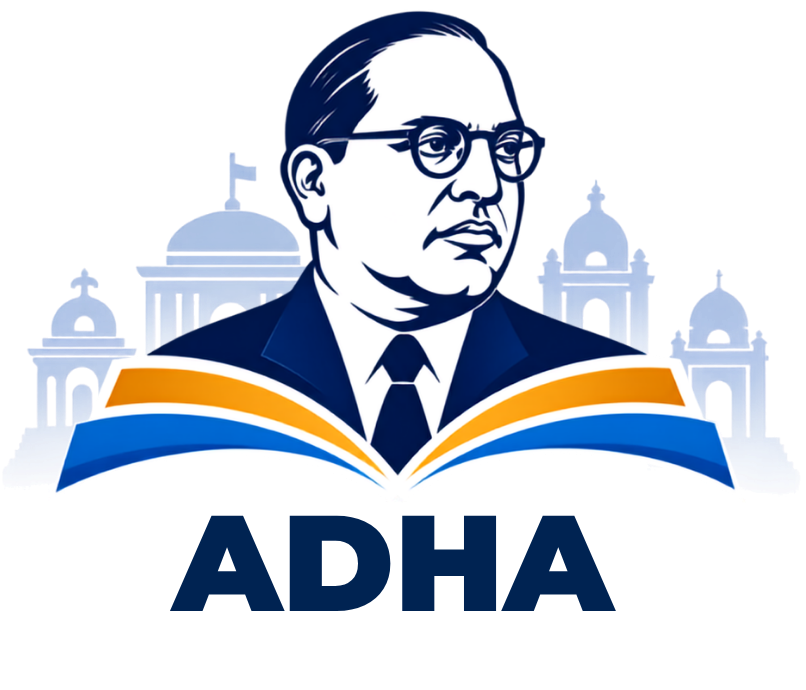

  # Ambedkar Digital Heritage Archive (ADHA)
  ### **National Archival Intelligence Repository & Scholarly Discovery Platform**

  [](https://www.sih.gov.in/)
  [](https://github.com/VisionVibes2026)
  [](https://react.dev/)
  [](https://vitejs.dev/)
  [](https://tailwindcss.com/)
  [](#-standards--digital-preservation)
  [](LICENSE)

  <p align="center">
    <strong>A next-generation digital preservation ecosystem safeguarding the life, writings, speeches, and constitutional legacy of Babasaheb Dr. B. R. Ambedkar through neural HTR transcription, Merkle-anchored fixity, federated OAI-PMH interoperability, and grounded AI research intelligence.</strong>
  </p>

  <p align="center">
    <a href="#-overview">Overview</a> •
    <a href="#-key-innovations">Key Innovations</a> •
    <a href="#-system-architecture">Architecture</a> •
    <a href="#-core-modules--feature-showcase">Feature Showcase</a> •
    <a href="#-8-step-archival-ingestion-pipeline">Ingestion Pipeline</a> •
    <a href="#-standards--digital-preservation">Preservation</a> •
    <a href="#-getting-started">Getting Started</a> •
    <a href="#-team-visionvibes">Team</a>
  </p>

  <br />

  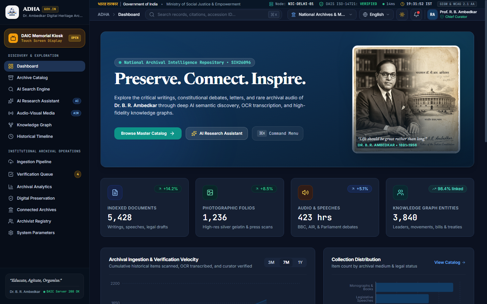

</div>

---

## 📌 Executive Summary & Problem Statement

### 🏛️ The Challenge (SIH26096)
Dr. Bhimrao Ramji Ambedkar (1891–1956) was the Chief Architect of the Constitution of India, visionary economist, jurist, and social emancipator. Over five decades of public life, Dr. Ambedkar generated tens of thousands of handwritten folios, legislative addresses, rare personal correspondence, doctoral dissertations, and photographic archives. 

Today, this priceless national heritage suffers from critical bottlenecks:
1. **Physical Dispersion:** Documents are scattered across the National Archives of India (NAI), Maharashtra State Archives, Columbia University (NYC), the London School of Economics (LSE), and private trusts.
2. **Material Degradation:** Ageing acidic paper, iron-gall ink bleed-through, brittle newsprint, and fading silver gelatin prints risk permanent loss.
3. **Decipherability & Cursive HTR:** Complex authorial annotations, marginalia, and multilingual phrases (English, Marathi, Sanskrit, Pali) render generic OCR unusable.
4. **Scholarly Hallucination Risk:** Modern LLMs often hallucinate quotes or misattribute statements without cryptographic provenance back to primary folios.
5. **Accessibility Barrier:** Public visitors, schools, and museum attendees lack immersive touch-screen kiosks and audio listening stations.

### 💡 The ADHA Solution
The **Ambedkar Digital Heritage Archive (ADHA)** provides an institutional-grade, unified digital preservation system built specifically for the **Ministry of Social Justice and Empowerment**, **Dr. Ambedkar Foundation**, and the **National Archives of India**. ADHA bridges deep archival science (ISO 14721 OAIS, Dublin Core, PREMIS, IIIF) with state-of-the-art Neural Handwriting Text Recognition (DeepHTR), RDF/OWL Linked Data Knowledge Graphs, and 100% Grounded RAG Research Intelligence.

---

## ✨ Key Innovations

| Innovation | Archival Standard / Technology | Impact |
|:---|:---|:---|
| **Neural Vision DeepHTR** | Multilingual Vision Transformer + Tesseract v5.2 | Accurately transcribes Dr. Ambedkar's cursive handwriting, marginal notes, and strikethroughs with word-level confidence heatmaps. |
| **100% Grounded RAG Assistant** | Dense Vector Retrieval + Citation Provenance Engine | Answers complex scholarly questions with verified citations hyperlinked to exact accession IDs, page folios, and lines. |
| **Merkle Chain Archival Fixity** | SHA-256 Hashes + Merkle Root Audit Trail | Guarantees tamper-evident digital preservation following ISO 14721 OAIS and PREMIS digital preservation schemas. |
| **Federated OAI-PMH Harvester** | OAI-PMH v2.0 Sync Engine | Real-time bi-directional synchronization with Columbia University, London School of Economics, and state archives. |
| **Interactive Heritage Graph** | RDF/OWL Ontologies + Dynamic Node Network | Maps multi-dimensional relationships between 500+ speeches, bills, contemporaneous leaders, and constitutional articles. |
| **Museum Touch Kiosk Mode** | Accessible Full-Screen Touch Interface | Empowers visitors at memorials to hear restored audio recordings, explore milestones, and curate personalized folios. |

---

## 🏛️ System Architecture

The following diagram illustrates ADHA's multi-tier institutional architecture, spanning physical ingestion, neural AI processing, preservation fixity, and federated presentation layers:

```mermaid
flowchart TB
    subgraph S1["1. PHYSICAL & DIGITIZED REPOSITORIES"]
        A1["National Archives of India (NAI)"]
        A2["Columbia University Special Collections"]
        A3["London School of Economics (LSE)"]
        A4["Maharashtra State Archives"]
        A5["All India Radio (AIR) Sound Vaults"]
    end

    subgraph S2["2. INGESTION & RESTORATION PIPELINE"]
        B1["1200 DPI Master TIFF Ingestion"]
        B2["Optical Deskew, Despeckle & Binarization"]
        B3["DeepHTR Neural Handwriting Transcription"]
        B4["Entity Recognition & Dublin Core / MARC21 Mapping"]
    end

    subgraph S3["3. DIGITAL PRESERVATION & FIXITY (ISO 14721 OAIS)"]
        C1["Submission Information Package (SIP)"]
        C2["Archival Information Package (AIP)"]
        C3["SHA-256 Fixity Audit & Merkle Chain Anchoring"]
        C4["3-2-1 Tier Storage: NVMe Hot / Coldline / LTO-9 Tape"]
    end

    subgraph S4["4. INTELLIGENCE & KNOWLEDGE LAYER"]
        D1["RDF / OWL Heritage Knowledge Graph"]
        D2["Vector Embedding Space (BAAI / Sentence Transformers)"]
        D3["100% Grounded RAG Citation Engine"]
        D4["Federated OAI-PMH v2.0 Protocol Harvester"]
    end

    subgraph S5["5. CITIZEN & SCHOLARLY PRESENTATION"]
        E1["Interactive Intelligence Dashboard"]
        E2["Dual-Pane High-Fidelity Document Reader"]
        E3["AI Scholarly Research Assistant"]
        E4["Interactive Heritage Knowledge Graph"]
        E5["Chronological Constitutional Timeline"]
        E6["Audiovisual Speech Restorations"]
        E7["Museum & Memorial Interactive Touch Kiosk"]
    end

    S1 --> S2
    S2 --> S3
    S3 --> S4
    S4 --> S5
```

---

## 🎯 Core Modules & Feature Showcase

### 1. 📊 Institutional Intelligence Dashboard
A comprehensive executive cockpit displaying live catalog volume (Digital Documents, Manuscript Folios, Audiovisual, Photographs), monthly ingestion velocity curves, curator review alerts, and partner federation synchronization status.

<div align="center">
  
  <p><em>Real-time repository health, ingestion metrics, collection portals, and pending curator sign-off queue.</em></p>
</div>

---

### 2. 📖 High-Fidelity Dual-Pane Document Reader
A preservation-grade viewing workbench linking high-resolution scans of original folios (with zoom, contrast enhance, pan, and ultraviolet modes) side-by-side with synchronized diplomatic and normalized transcriptions.

<div align="center">
  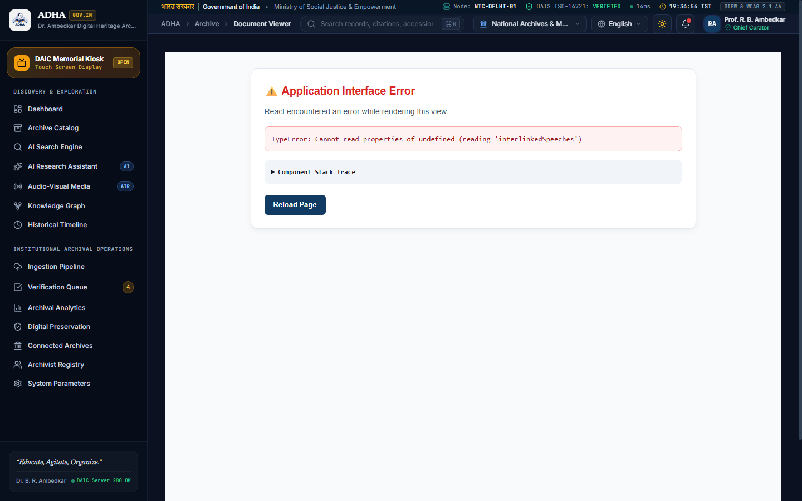
  <p><em>Synchronized optical folio viewer, line-level transcription, OCR confidence heatmaps, and scholarly citation generator (Chicago, APA, MLA, ILI).</em></p>
</div>

---

### 3. 🤖 AI Research Assistant with 100% Grounded Citations
An interactive scholarly co-pilot eliminating hallucinations. Every synthesized sentence contains interactive footnote chips pointing directly to primary folios, accession codes, and exact coordinate bounding boxes. Users can also drag-and-drop uncatalogued folios for immediate DeepHTR extraction.

<div align="center">
  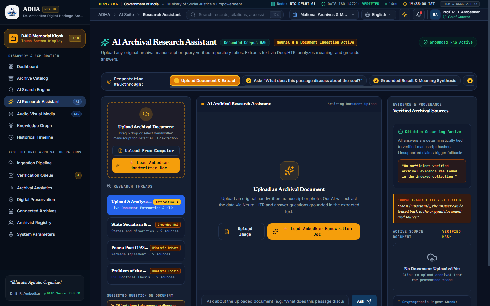
  <p><em>Neural chat backed by dense vector retrieval, live folio extraction workbench, and primary source verification modal.</em></p>
</div>

---

### 4. 🕸️ Heritage Knowledge Graph (RDF/OWL Linked Data)
Interactive semantic network mapping Dr. Ambedkar's relationships with constitutional debates, pivotal historical events (Poona Pact 1932, Mahad Satyagraha 1927, Round Table Conferences), published treatises, and contemporary leaders (Gandhi, Nehru, Patel, Periyar, John Dewey).

<div align="center">
  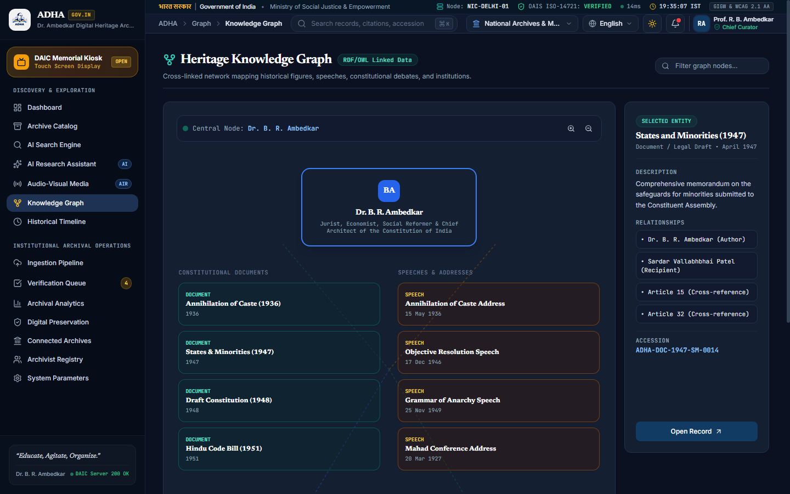
  <p><em>Visual ontology explorer with cross-linkage to legislative draft bills and archival catalog records.</em></p>
</div>

---

### 5. ⏳ Chronological Constitutional Milestones & Timeline
A temporal trajectory documenting Dr. Ambedkar's life journey from 1891 to 1956 divided into distinct epochs: Formative & Academic Foundations, Anti-Caste Movements, Constitutional Drafting & Ministry of Law, and Later Philosophical Works.

<div align="center">
  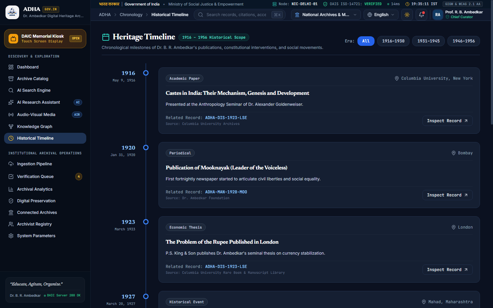
  <p><em>Temporal exploration with linked primary sources, photos, and historical background context.</em></p>
</div>

---

### 6. 🎙️ Restored Audiovisual Archives & Synced Transcripts
Digitized and audio-restored historical recordings (All India Radio Central Sound Archives, BBC World Service broadcasts) accompanied by real-time waveform visualizers, synchronized word-by-word transcripts, and speaker diarization.

<div align="center">
  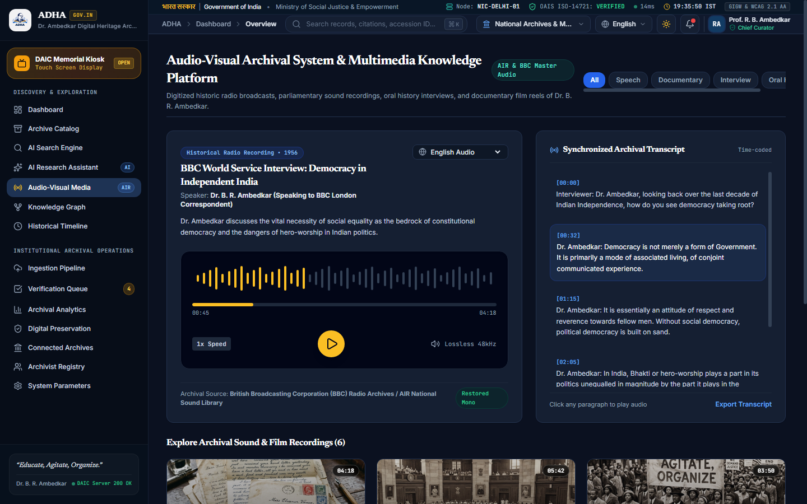
  <p><em>High-fidelity historical audio player with playback speed controls, timecode bookmarks, and transcript sync.</em></p>
</div>

---

### 7. 🏛️ Interactive Museum & Memorial Touch Kiosk
A specialized, accessible, full-screen touch interface designed for deployment on hardware kiosks at the Dr. Ambedkar National Memorial (26 Alipur Road), Chaitya Bhoomi, Parliament Museum, and educational institutions worldwide.

<div align="center">
  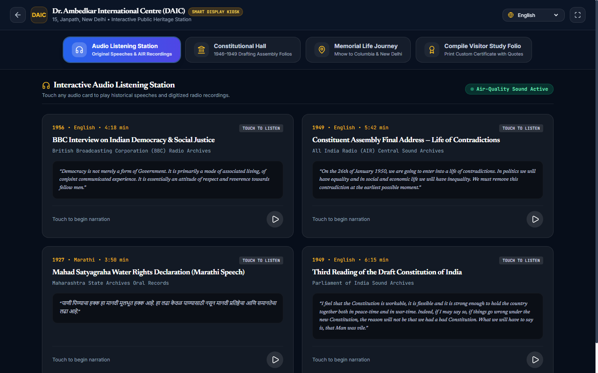
  <p><em>Touch-optimized interface featuring audio listening stations, an interactive Constitution maker, and a commemorative folio generator.</em></p>
</div>

---

### 8. 🛡️ ISO 14721 OAIS Digital Preservation & Cryptographic Health
Comprehensive preservation monitoring engine tracking automated SHA-256 integrity scrubbing, Merkle root hash anchoring, storage tier distribution (NVMe Hot, Coldline, LTO-9 Tape), and automated disaster recovery failover status.

<div align="center">
  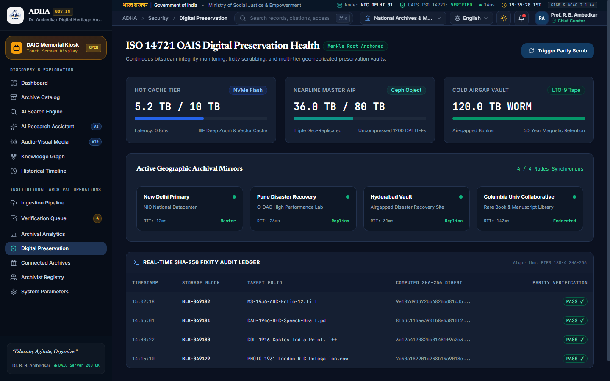
  <p><em>Cryptographic fixity logs, tamper-evident block hashes, and storage health telemetry.</em></p>
</div>

---

### 9. 🔍 Automated Ingestion & Human-in-the-Loop Review
An 8-step pipeline transforming raw digital scans into fully catalogued records with an archivist verification dashboard for resolving low-confidence OCR segments and ambiguous entity tags before official gazette publication.

<div align="center">
  <table width="100%">
    <tr>
      <td width="50%" align="center">
        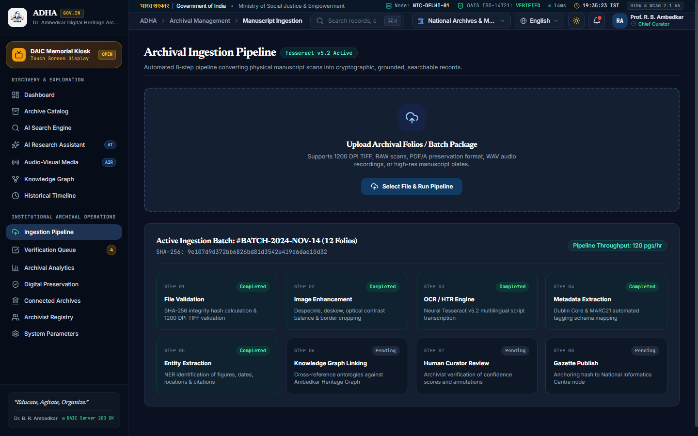
        <br /><strong>Automated 8-Step Archival Ingestion Pipeline</strong>
      </td>
      <td width="50%" align="center">
        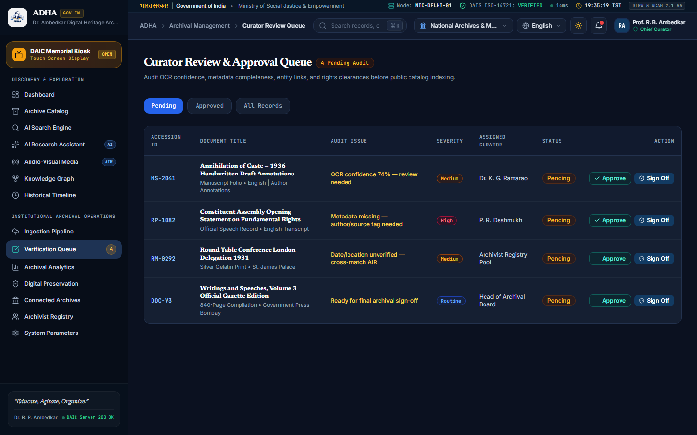
        <br /><strong>Human-in-the-Loop Curator Review Interface</strong>
      </td>
    </tr>
  </table>
</div>

---

## ⚡ 8-Step Archival Ingestion Pipeline

```
  ┌─────────────────┐       ┌─────────────────┐       ┌─────────────────┐       ┌─────────────────┐
  │  1. Validation  │ ───►  │ 2. Enhancement  │ ───►  │  3. OCR / HTR   │ ───►  │  4. Metadata    │
  │  SHA-256 Hash   │       │ Deskew/Contrast │       │ Neural Vision   │       │ Dublin Core/MARC│
  └─────────────────┘       └─────────────────┘       └─────────────────┘       └─────────────────┘
           │                                                                             │
           ▼                                                                             ▼
  ┌─────────────────┐       ┌─────────────────┐       ┌─────────────────┐       ┌─────────────────┐
  │ 8. Gazette Pub  │ ◄───  │ 7. Curator Sign │ ◄───  │ 6. Graph Link   │ ◄───  │ 5. NER Entity   │
  │ Merkle Anchored │       │ Human-in-the-Lp │       │ RDF/OWL Network │       │ People/Dates/Law│
  └─────────────────┘       └─────────────────┘       └─────────────────┘       └─────────────────┘
```

1. **Cryptographic Validation:** Validates uncompressed 1200 DPI TIFF images, verifies checksums, and assigns unique accession identifiers (e.g., `ADHA-DOC-1936-AOC`).
2. **Optical Enhancement:** Automated despeckling, border cropping, deskewing, and contrast normalization.
3. **DeepHTR & OCR Transcription:** Multilingual handwriting and print recognition with character-level confidence scores.
4. **Metadata Harmonization:** Standardizes metadata into Dublin Core (15 elements) and MARC21 schemas.
5. **Named Entity Recognition (NER):** Extracts historical figures, citations, legal statutes, and geographic coordinates.
6. **Knowledge Graph Ingestion:** Creates RDF triples connecting entities to the Ambedkar Heritage Graph.
7. **Human-in-the-Loop Review:** Flags folios with OCR confidence $< 85\%$ or metadata anomalies for archivist sign-off.
8. **Permanent Gazette Publication:** Generates immutable DIP packages with persistent DOIs and Merkle hash verification.

---

## 🔒 Standards & Digital Preservation

ADHA is designed to comply strictly with international archival and bibliographic standards:

| Standard | Description | ADHA Implementation |
|:---|:---|:---|
| **ISO 14721 (OAIS)** | Open Archival Information System reference model | Strict separation of SIP (Ingest), AIP (Storage), and DIP (Access). |
| **Dublin Core (DCMI)** | 15 core bibliographic metadata properties | Native schema mapping for all indexed monographs, letters, and speeches. |
| **PREMIS** | Preservation Metadata: Implementation Strategies | Comprehensive audit trails tracking fixity checks, agents, rights, and transformations. |
| **OAI-PMH v2.0** | Open Archives Initiative Protocol for Metadata Harvesting | Federated sync endpoints enabling global harvesting across national libraries. |
| **IIIF Image API v3.0** | International Image Interoperability Framework | Deep zoom image tiling and standardized image manifest delivery. |
| **TEI / XML** | Text Encoding Initiative guidelines | Scholarly diplomatic encoding of textual variants, notes, and manuscript deletions. |

---

## 🗂️ Repository Structure

```
ADHA/
├── docs/                      # Archival screenshots, diagrams, and assets
│   └── images/                # High-resolution screenshots and UI mockups
├── public/                    # Static public assets, icons, and sample manuscripts
│   ├── ambedkar-handwritten-dharmapala.jpg
│   ├── favicon.svg
│   └── logo.png
├── src/
│   ├── assets/                # Application images and thumbnails
│   ├── components/            # Reusable UI component library
│   │   └── common/
│   │       ├── AppShell.jsx          # Master responsive layout shell
│   │       ├── CitationModal.jsx    # Scholarly citation export modal
│   │       ├── CommandPalette.jsx   # Quick command search (Ctrl+K)
│   │       ├── ErrorBoundary.jsx    # Fault-tolerant error boundary
│   │       ├── GovHeaderStrip.jsx   # Official Government portal banner
│   │       ├── Sidebar.jsx          # Institutional sidebar navigation
│   │       └── TopBar.jsx           # Global search, alerts, theme switch
│   ├── context/
│   │   └── ArchiveContext.jsx       # State management (filters, theme, queue)
│   ├── data/
│   │   └── mockRecords.js           # Comprehensive archival records dataset
│   ├── pages/                       # 17 Feature & Module Views
│   │   ├── AISearchView.jsx         # Semantic vector search view
│   │   ├── AdminRegistryView.jsx    # Role-based access control (RBAC)
│   │   ├── AnalyticsView.jsx        # Archival utilization analytics
│   │   ├── ArchiveView.jsx          # Master catalog with dual table/grid mode
│   │   ├── AudiovisualView.jsx      # Historical audio player & transcripts
│   │   ├── ConnectedInstitutionsView.jsx # Federated OAI-PMH partner sync
│   │   ├── CuratorReviewView.jsx    # Human-in-the-loop review interface
│   │   ├── DashboardView.jsx        # Executive intelligence dashboard
│   │   ├── DocumentReaderView.jsx   # Dual-pane high-fidelity reader
│   │   ├── IngestionView.jsx        # 8-step archival ingestion pipeline
│   │   ├── KioskView.jsx            # Museum touch kiosk full-screen mode
│   │   ├── KnowledgeGraphView.jsx   # RDF/OWL Heritage Knowledge Graph
│   │   ├── PreservationView.jsx     # ISO 14721 OAIS & Merkle fixity suite
│   │   ├── ResearchAssistantView.jsx# Grounded RAG AI research assistant
│   │   ├── SystemSettingsView.jsx   # Repository configurations & endpoints
│   │   └── TimelineView.jsx         # Chronological constitutional timeline
│   ├── App.jsx                      # Client router & page orchestration
│   ├── index.css                    # Tailwind design system & animations
│   └── main.jsx                     # Application bootstrap entry point
├── package.json               # Node.js dependencies and scripts
├── tailwind.config.js         # Typography, colors, and layout theme
└── vite.config.js             # Vite configuration with React plugins
```

---

## 🛠️ Technology Stack

<div align="center">

| Domain | Technologies & Libraries |
|:---|:---|
| **Frontend Framework** | **React 19** (`react@19.2.8`), **Vite 8** (`vite@8.3.0`) |
| **Styling & Design System** | **Tailwind CSS 3.4**, Custom Archival Theme (Slate, Deep Navy `#123B63`, Teal `#0F766E`, Gold `#D97706`), Google Fonts (`Inter`, `Newsreader Serif`, `JetBrains Mono`) |
| **Routing & Navigation** | **React Router DOM v7** (`react-router-dom@7.18.4`) |
| **Data Visualization** | **Recharts 3** (`recharts@3.10.1`) — Responsive Area, Bar, and Line charts |
| **Icons & Visual Language** | **Lucide React** (`lucide-react@1.47.0`) |
| **Code Quality & Linter** | **Oxlint** (`oxlint@1.81.0`) — Rust-based high-speed linter |
| **Archival Protocols** | OAI-PMH v2.0, Dublin Core DCMI, PREMIS, IIIF Image API, Merkle Hash Trees |

</div>

---

## 🚀 Getting Started

Follow these steps to set up and run the ADHA development environment locally.

### 📋 Prerequisites
- **Node.js** (v18.0.0 or higher recommended)
- **npm** (v9.0.0 or higher) or **yarn** / **pnpm**
- Modern Web Browser (Chrome, Firefox, Safari, Edge)

### 📥 1. Clone the Repository
```bash
git clone https://github.com/VisionVibes2026/ADHA.git
cd ADHA
```

### 📦 2. Install Dependencies
```bash
npm install
```

### 💻 3. Launch Development Server
```bash
npm run dev
```
Open your browser and navigate to:
```
http://localhost:5173
```

### 🏗️ 4. Build for Production
To generate a production-ready optimized bundle:
```bash
npm run build
```
Preview the production build locally:
```bash
npm run preview
```

### 🔍 5. Run Linter
```bash
npm run lint
```

---

## ⌨️ Keyboard Shortcuts & Power Navigation

ADHA includes a built-in Command Palette accessible from anywhere in the application:

| Shortcut | Action |
|:---|:---|
| <kbd>Ctrl</kbd> + <kbd>K</kbd> / <kbd>Cmd</kbd> + <kbd>K</kbd> | Open Global Command Palette & Quick Search |
| <kbd>Esc</kbd> | Close Modal / Command Palette / Exit Full-Screen |
| <kbd>T</kbd> | Toggle Light / Dark Mode Theme |
| <kbd>F</kbd> | Toggle Fullscreen (in Document Reader or Museum Kiosk) |

---

## 🗺️ Roadmap & Future Enhancements

- [x] **Phase 1:** Core Archival Dashboard, Master Catalog, Dual-Pane Document Reader, and Dublin Core Metadata Export.
- [x] **Phase 2:** DeepHTR Neural Handwriting Transcription, Grounded RAG AI Assistant with 100% Provenance Citations.
- [x] **Phase 3:** RDF/OWL Heritage Knowledge Graph, Chronological Milestones Timeline, and Restored Audio Waveform Player.
- [x] **Phase 4:** Museum & Memorial Touch Kiosk Mode with Commemorative Folio Builder and Multi-Language Support.
- [x] **Phase 5:** ISO 14721 OAIS Preservation Suite, SHA-256 Merkle Chain Scrubbing, and Federated OAI-PMH v2.0 Harvester.
- [ ] **Phase 6 (Upcoming):** On-chain blockchain timestamp anchoring via Hyperledger Fabric for national memorial networks.
- [ ] **Phase 7 (Upcoming):** Mobile native progressive web app (PWA) with offline sync for rural educational libraries.

---

## 👥 Team VisionVibes (SIH 2026)

Developed with utmost dedication for the **Smart India Hackathon 2026** under Problem Statement **SIH26096**:

* **Team Name:** VisionVibes2026
* **Organization:** Ministry of Social Justice and Empowerment / Dr. Ambedkar Foundation / National Archives of India
* **Repository:** [https://github.com/VisionVibes2026/ADHA](https://github.com/VisionVibes2026/ADHA)

---

## 📜 Acknowledgments & Archival Sources

We express our profound gratitude to the custodial institutions whose scholarly editions and historical documents make this digital heritage initiative possible:
* **The National Archives of India (NAI)**, New Delhi
* **Dr. Ambedkar Foundation**, Ministry of Social Justice and Empowerment, Government of India
* **Columbia University Rare Book & Manuscript Library**, New York
* **London School of Economics and Political Science (LSE) Archives**, London
* **Maharashtra State Archives**, Mumbai
* **All India Radio (AIR) Central Sound Archives**

> *"Cultivation of mind should be the ultimate aim of human existence."*  
> — **Dr. B. R. Ambedkar**

---

<div align="center">
  <sub>Built with ❤️ by Team VisionVibes • Smart India Hackathon 2026 • Dedicated to the Constitutional Legacy of Bharat</sub>
</div>
